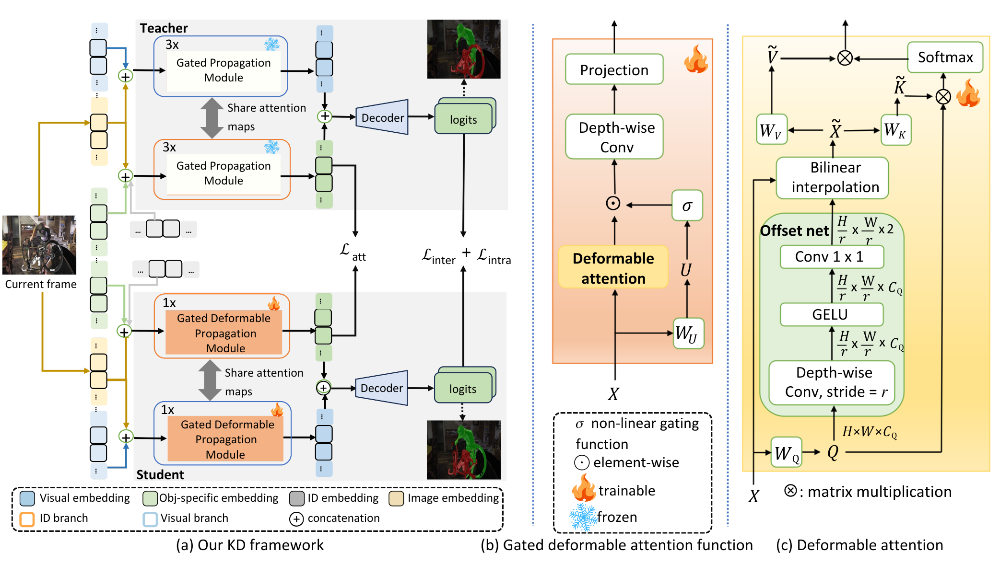
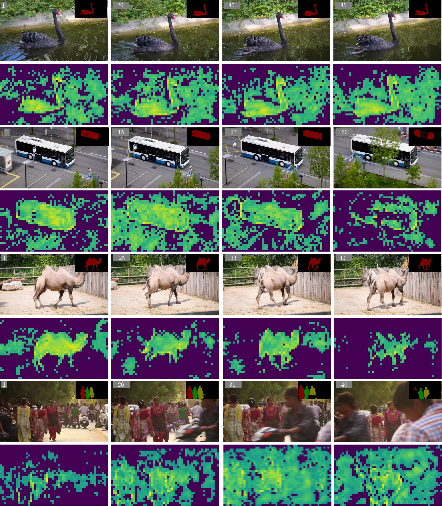
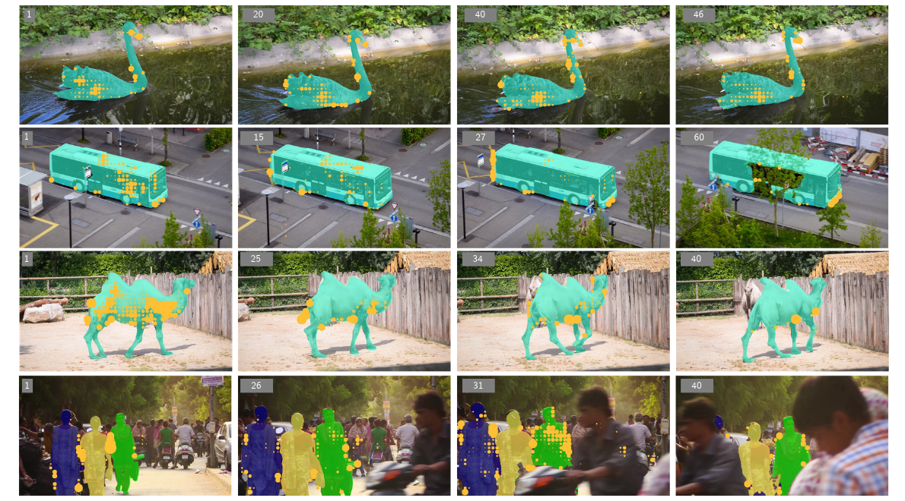
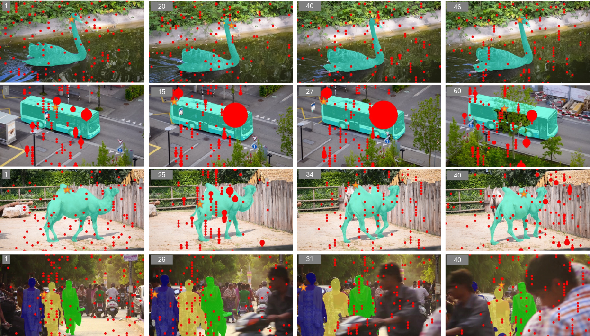

# DiDA: Video Object Segmentation with Distillation Learning of Deformable Attention

Quang-Trung Truong, Duc Thanh Nguyen, Binh-Son Hua, Sai-Kit Yeung

**Asian Conference on Computer Vision 2026**

[[arXiv]](https://arxiv.org/abs/2401.13937)

Official implementation of **DiDA** (ACCV 2026).

## Abstract

Video object segmentation is a fundamental research problem in computer vision. Recent techniques have often applied attention mechanism to object representation learning from video sequences. However, due to temporal changes in the video data, attention maps may not well align with the objects of interest across video frames, causing accumulated errors in long-term video processing. In addition, existing techniques have utilised complex architectures, requiring highly computational complexity and hence limiting the ability to integrate video object segmentation into low-powered devices. To address these issues, we propose DiDA, a new method for video object segmentation based on Distillation Learning of Deformable Attention. Specifically, we devise a lightweight architecture for video object segmentation that is effectively adapted to temporal changes. This is enabled by deformable attention mechanism, where the keys and values capturing the memory of a video sequence in the attention module have flexible locations updated across frames. The learnt object representations are thus adaptive to both the spatial and temporal dimensions. We train the proposed architecture using a new knowledge distillation paradigm where deformable attention maps are integrated into the distillation loss. We qualitatively and quantitatively evaluate our method and compare it with existing methods on benchmark datasets including DAVIS 2016/2017 and YouTube-VOS 2018/2019. Experimental results verify the superiority of our method via its achieved state-of-the-art performance on YouTube-VOS18 dataset and optimal memory usage.

## Framework

<p align="center">
  
</p>

**Summary of our proposed VOS method.** (a) Overview of our knowledge distillation method. The teacher model transfers intermediate attention maps to the student model. This transfer is enforced by a CKA-based loss L<sub>att</sub>. At the same time, probability distributions of logits are transferred using intra-object and inter-object losses L<sub>intra</sub> and L<sub>inter</sub>. Both the teacher and student models make use of the Gated Propagation Module (GPM), aiming to propagate spatio-temporal information across frames via the attention mechanism. (b) Our proposed Gated Deformable Attention function, which is used to implement the GPM. (c) Deformable attention module, which is used to replace the vanilla attention in the Gated Deformable Attention function.

## Visualization

<p align="center">
  
</p>

**Visualisation of the deformable attention maps of the distilled attention layer in the student network on DAVIS 2017 val.** For each test case, we present a query frame (frame ID shown in the left corner) and its corresponding ground-truth segmentation masks (top-right corner). For ease of presentation, we only display pixels whose attention map value is greater than 0.5. As shown, pixels on the target objects are highlighted (i.e., they are often associated with high attention map values) on the deformable attention maps. We found that those pixels also correspond to large temporal changes, showcasing the adaptability of the deformable attention mechanism to both the spatial and temporal dimensions.

<p align="center">
  
</p>

**Keypoints (yellow dots) from deformable attention maps on DAVIS 2017 val.** The radius of each keypoint is proportional to the attention map value of the distilled attention layer in the student network at that keypoint.

<p align="center">
  
</p>

**Query tokens (yellow stars) and corresponding key tokens (red dots) identified from deformable attention maps on DAVIS 2017 val.** The radius of each key token is proportional to the similarity between that key token and its input query token.

## Requirements

- Linux with NVIDIA GPUs (2 GPUs for training by default, NCCL backend)
- PyTorch and torchvision matching your CUDA version
- Additional packages:

  ```bash
  pip install numpy opencv-python Pillow einops timm tensorboardX
  ```

## Data Preparation

Datasets are resolved relative to the repository root, with the default data root `../../data/`:

```text
../../data/
├── static/                   # Stage 1: coco, BIG_small, DUTS-TE, DUTS-TR, ecssd, fss, HRSOD_small
├── YTB/YouTube/{train,valid}/ # Stage 2 + evaluation (JPEGImages/, Annotations/, meta.json)
└── DAVIS/
    ├── 2017/{trainval,test-dev}/
    └── 2016/trainval/
```

Static datasets contain `.jpg` images with matching `.png` masks. DAVIS follows the standard `JPEGImages/`, `Annotations/`, `ImageSets/` layout. See [`datasets/`](./datasets/) for details.

## Pretrained Weights

Place the following checkpoints in `pretrain_models/`:

| File | Role |
|------|------|
| `mobilenet_v2-b0353104.pth` | Student backbone initialization |
| `R50_DeAOTL_PRE_YTB_DAV.pth` | ResNet-50 DeAOT teacher |

## Training and Evaluation

```bash
bash run.sh
```

The script runs two training stages (100k steps each) — static pre-training (`pre`) followed by YouTube-VOS + DAVIS fine-tuning (`pre_ytb_dav`) — then evaluates on DAVIS 2016/2017 and YouTube-VOS 2018/2019. Stage 2 initializes from the Stage 1 EMA checkpoint.

GPUs are set via `CUDA_VISIBLE_DEVICES` in `run.sh`; keep `gpu_num` consistent with it. Checkpoints and logs are saved to `result/`; predictions to `results/`.

## Citation

If you find this work useful, please cite:

```bibtex
@misc{truong2026didavideoobjectsegmentation,
      title={DiDA: Video Object Segmentation with Distillation Learning of Deformable Attention},
      author={Quang-Trung Truong and Duc Thanh Nguyen and Binh-Son Hua and Sai-Kit Yeung},
      year={2026},
      eprint={2401.13937},
      archivePrefix={arXiv},
      primaryClass={cs.CV},
      url={https://arxiv.org/abs/2401.13937},
}
```
